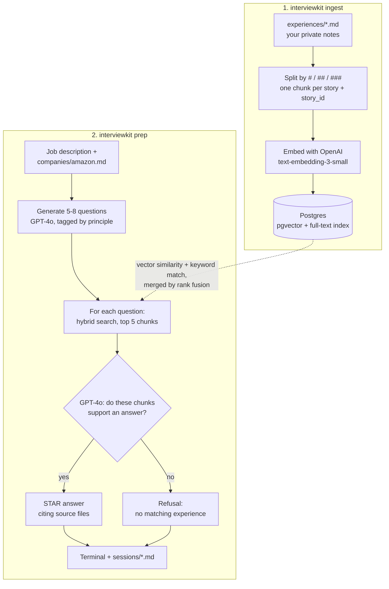

# InterviewKit

    

A local CLI that turns your own work notes into company-specific behavioral
interview prep. You write markdown about real projects. InterviewKit indexes
them in pgvector, generates the questions a company is likely to ask, and drafts
STAR answers that cite the notes they came from. If your notes don't cover a
question, it says so instead of inventing a story.

## How It Works



1. **Ingest** turns each story in your notes into a chunk, keeps its headings
   in the text, and stores it with both an embedding and a full-text index.
2. **Prep** asks GPT-4o for the questions a company would ask, finds the best
   five chunks per question by combining meaning-based and keyword search, and
   drafts an answer only from those chunks, or refuses if none fit.
3. **Eval** (`interviewkit eval`) runs a golden set through step 2 and scores
   it, so every change to retrieval or prompts is measured.

## Quickstart

```bash
python -m venv .venv && source .venv/bin/activate
pip install -e '.[dev]'
cp .env.example .env              # add OPENAI_API_KEY
docker compose up -d              # Postgres 15 + pgvector

interviewkit init-db
interviewkit ingest               # index experiences/*.md
interviewkit prep --jd jd.txt --company amazon
```

Output prints to the terminal and is saved under `sessions/`.

## Writing Experience Notes

Copy `experiences/_template.md` for each job or project and fill it in. Answers
are only as good as these notes, so cover what you owned, the decisions you made,
what broke, the tradeoffs, and the numbers. Your filled-in files are git-ignored
and never leave your machine except as embedding and LLM API calls.

Company profiles live in `companies/` (Amazon and Microsoft included). Copy
`companies/_template.md` to add another.

## Measuring Quality

`interviewkit eval` runs a golden set of questions through retrieval and answer
drafting, then prints a scorecard. Every metric is checked in code, with no
LLM grading another LLM:

- **Recall@k**: was the expected story retrieved?
- **Groundedness**: were all cited sources actually retrieved?
- **Metric fidelity**: does every number in the answer appear in a cited chunk?
- **Refusal accuracy**: did it refuse exactly when there was no matching story?

It also reports latency and cost. Put your golden set in the git-ignored
`evals/golden.jsonl` (format: `evals/golden.example.jsonl`), then run
`interviewkit eval --golden evals/golden.jsonl --mode hybrid`.

Retrieval is hybrid by default: pgvector similarity plus Postgres full-text
search, merged with reciprocal rank fusion. On 40 cases it lifted story-level
recall@5 from 56% to 73% with 0 unsupported numbers (`resources/quality-results.md`).

## Tracing (optional)

Run a self-hosted [Langfuse](https://langfuse.com) to inspect every step, prompt,
and token cost:

```bash
docker compose --profile tracing up -d
```

Set `LANGFUSE_PUBLIC_KEY` and `LANGFUSE_SECRET_KEY` in `.env` (any `pk-lf-...` /
`sk-lf-...` values; the server creates a project with that key pair on first
boot), then open <http://localhost:3000>. Set `LANGFUSE_PORT` and `LANGFUSE_HOST`
if port 3000 is taken. Tracing is off when the keys are unset. It's self-hosted
because traces contain your private notes.

## MCP Server

`interviewkit serve-mcp` exposes `init_database`, `ingest_experiences`, and
`search_experiences` to MCP clients like Claude Code:

```bash
claude mcp add interviewkit -- /abs/path/.venv/bin/python -m interviewkit \
  serve-mcp --project-dir /abs/path/to/interviewKit
```

`--project-dir` is required because MCP clients start the server from an
arbitrary directory.

## Stack

Python 3.11+, Typer, LangChain, LangGraph, OpenAI (GPT-4o, `text-embedding-3-small`;
optional Claude adapter), PostgreSQL 15 + pgvector, Langfuse (self-hosted tracing),
MCP, Pydantic Settings, pytest, Docker Compose.

## What's Next

A bounded agent for story selection that avoids reusing stories, followed by a
deterministic grounding check on every answer.
Each change is measured against the golden set.
